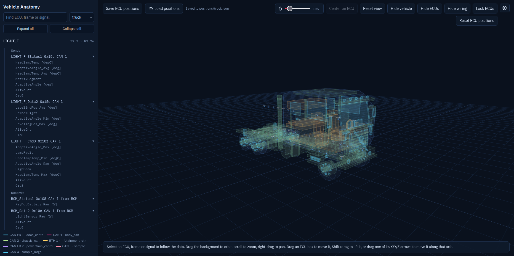
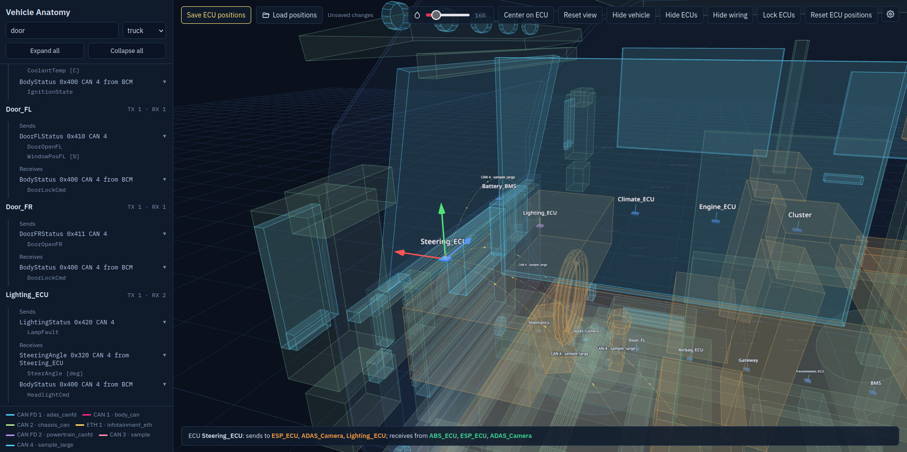
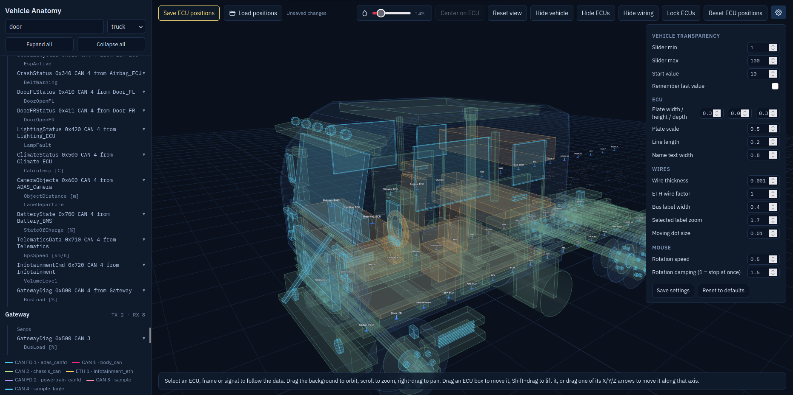

# Vehicle Anatomy

Vehicle Anatomy parses DBC files and displays their ECUs, messages, signals, and bus connections inside an interactive 3D vehicle model. Each DBC file represents one bus. ECUs shared across files appear as gateways between buses.

## Screenshots








## Requirements

- Python 3
- A modern browser with WebGL support
- An internet connection in the browser to load Three.js from jsDelivr and fonts from Google Fonts

The Python application uses only the standard library. No `pip` packages or virtual environment are required.

## Quick Start

From the project directory, run the bundled example DBC files:

```sh
./run.sh
```

The launcher starts the local server on port `8000` and opens the page in your browser. If it does not open automatically, visit <http://localhost:8000/>. Stop the server with `Ctrl+C`. The launcher uses the bundled DBC files and forwards any command-line options to the app.

If port `8000` is already in use, choose another port:

```sh
./run.sh --port 8080
```

## Use Your Own DBC Files

Run the Python app directly and provide one or more DBC files or directories. Directories are searched recursively for `.dbc` files.

```sh
python3 main.py path/to/powertrain.dbc path/to/body.dbc --vehicle truck
python3 main.py path/to/dbc_directory --vehicle car --port 8080
```

Available options:

- `--vehicle NAME`: select a design from `vehicles/` (`car`, `truck`, or `airplane`). The default is `truck` when available.
- `--bus-type NAME=TYPE`: override a bus type, where `NAME` is the DBC filename without its extension. Repeat this option for multiple buses.
- `--channel NAME=CHANNEL`: set a displayed channel name for a bus. Repeat as needed.
- `--positions DIRECTORY`: use a different directory for saved ECU positions.
- `--port PORT`: set the local HTTP server port (default `8000`).
- `--no-browser`: start the server without opening a browser.
- `-h`, `--help`: show command-line help.

For example, to identify a bus as Ethernet and assign its channel label:

```sh
python3 main.py path/to/backbone.dbc --bus-type backbone=ETH --channel 'backbone=ETH 1'
```

Bus types are read from the DBC `BusType` attribute when present, or inferred from the filename. Otherwise the app uses `CAN`. Channel labels are numbered by bus type unless explicitly set.

## Using the Viewer

- Select an ECU, frame, or signal in the sidebar to inspect its connections.
- Drag the background to orbit, scroll to zoom, and right-drag to pan.
- Drag an ECU to reposition it. Hold `Shift` while dragging to lift it, or drag an axis arrow to move it along that axis.
- Use the viewer controls to show or hide vehicle geometry, ECUs, and wiring, reset the view, or adjust vehicle opacity.
- Save ECU positions from the viewer. Positions are stored in `positions/<vehicle>.json` and loaded again for that vehicle.
- Viewer display settings changed through the gear menu are stored in `settings.json`.

## Project Files

- `main.py`: DBC parser, local web server, and viewer application.
- `run.sh`: launcher for the bundled DBC examples.
- `dbc/`: sample DBC files, including CAN FD and Ethernet examples.
- `vehicles/`: 3D vehicle designs (`car.js`, `truck.js`, and `airplane.js`).
- `positions/`: saved ECU positions for each vehicle design.
- `images/`: Images used in README.md documentation.
- `settings.json`: saved viewer display settings.

## License

This project is distributed under the GNU General Public License, version 3. See [LICENSE](LICENSE).